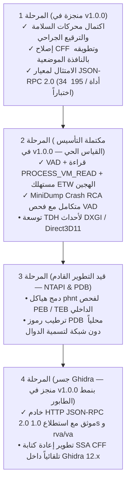

# Bintra: Strategic Direction, Architectural Decisions & Roadmap
## التوجه الاستراتيجي، القرارات المعمارية وخريطة الطريق الهندسية

---

## 1. الهوية الهندسية والرؤية الأساسية (Core Identity & Mission)

مشروع **`Bintra`** هو إطار عمل هندسي وأمني متقدم مصمم للوكلاء الأذكياء (Agent-Native) يركز بشكل صارم على:
> **الهندسة العكسية الدلالية المستمرة، والتشخيص الجنائي للأعطال، والترقيع الجراحي الآمن للبرمجيات المجمعة على نظام Windows (`.exe` و `.dll` بصيغتي PE32 و PE32+) والنماذج العصبية المدمجة بداخلها (Safetensors, ONNX, DirectML).**

### حسم الحدود ونطاق المشروع (Project Boundary & Scope)
- **ما يدخل في نطاق المشروع (In Scope):**
  - **منظومة القياس الحي والتشخيص الجنائي (Runtime Telemetry & Memory Diagnostics):** فحص الذاكرة الافتراضية VAD، وقراءة محتويات الذاكرة سلبياً عبر `PROCESS_VM_READ`، والبحث الأولي واللاحق عن القيم (First/Next Scan)، واكتشاف مسارات المؤشرات (Pointer Paths)، واستنتاج بنى البيانات (Structure Dissection)، وتتبع الأحداث السببية عبر ETW و MiniDump، وحقن التحليلات في Ghidra. هذه المنظومة **للقراءة فقط بنسبة 100% (Strictly Read-Only)** وتمنع منعاً باتاً أي تعديل على ذاكرة العملية الحية.
  - **مخرجات الترقيع الجراحي غير المباشر (Offline Surgical Patching):** أداة إصلاحية خارجية ومستقلة لتوليد نسخة مصححة جديدة في مساحة العمل حصراً (`--output`) مع إعادة حساب PE Checksum وتوازن المكدس، دون المساس بالملف التنفيذي قيد التشغيل أو ذاكرته الحية.
  - **تدقيق أوزان الذكاء الاصطناعي المدمجة دون تشغيلها (Zero-Execution Auditing):** اكتشاف المحفزات الخبيثة (Trojans / Backdoors) وشل حركتها لحماية النظام المضيف.
- **ما يقع خارج نطاق المشروع (Out of Scope):**
  - المشروع **ليس** بيئة لتدريب أو تحسين أو دمج نماذج الذكاء الاصطناعي العامة (LLMs) المستقلة.
  - المشروع **لا يمارس ولا يتضمن** أي تعديل على ذاكرة العمليات قيد التشغيل (`WriteProcessMemory`) أو تجاوز صلاحيات صفحات الذاكرة (`VirtualProtectEx`)، أو حقن المكتبات، أو أدوات التلاعب البرمجي.
  - التجارب المستمدة من أبحاث MIT CSAIL (*"Sparks of Weight-Space Programming"*) مثل `WeightSpaceCompiler` و `CircuitGrafter` محفوظة في المستودع كـ **أرشيف تاريخي وبحثي (Experimental Lineage)** لربط الفضاء الرياضي بالهندسة العكسية، وتُطلق تحذيراً نطاقياً (Scope Warning) عند استدعائها لتوضيح أنها ليست منتجاً لتوليد النماذج.

---

## 2. مراجعة نتائج التدقيق المستقل وحقائق الأداء (Audit Ground Truth Reconciliation)

بناءً على نتائج التدقيق التقني المستقل وحزم الاختبارات الشاملة (195 اختباراً مؤتمتاً شاملاً لوحدات ويندوز والتدقيق العابر للمنصات)، تم حسم الفجوات بين الادعاءات السابقة والسلوك الفعلي وتثبيتها كالآتي:

| المكون / التقنية | الحالة السابقة قبل المراجعة | الحالة المحققة والمثبتة في v1.0.0 | التوجه والتوصية |
|---|---|---|---|
| **حساب PE Checksum والترقيع الجراحي** | ادعاء حساب دقيق | **متحقق ومطابق** لخوارزمية `CheckSumMappedFile` المعتمدة من مايكروسوفت على عينات الاختبار. | اعتماد المحرك كمعيار أساسي مع حظر الكتابة في المكان (`Target Immutability`). |
| **كيرنل الأمان وحظر التجاوزات** | فحص المسارات فقط | **صلب ومختبر** ضد محاولات التجاوز عبر الروابط الثابتة (`Hard-links`)، والروابط الرمزية، وتجاوز المسارات، والمساس بالمكدس. | الإبقاء على نموذج `ExecutionGuard Fail-Closed` وفرض استمرار سجل التدقيق للترقيع. |
| **كشف تسطيح التحكم (CFF)** | كشف واسع يطلق إنذارات كاذبة على البرامج العادية (`/bin/ls`, `libc`) | **تم تقييده بنافذة دائرية موضعية (<= 1024 بايت)** مع اشتراط انتظام الإيقاع (`cadence >= 0.35`) وتعديلات متقاربة على نفس المتغير. | الحد من الإنذارات الكاذبة على مخرجات المترجم القياسية. |
| **كشف الشروط الصماء (Opaque Predicates)** | مسار Capstone قوي، ولكن المسار الاحتياطي يعيد خطأ قراءة `xor r8, rax` | **تم إصلاح المسار الاحتياطي بالقفز بطول التعليمة الكامل** وإضافة بحث أمامي (Lookahead) عبر التعليمات الآمنة (`mov`, `nop`, `lea`). | تغطية متسقة سواء توفرت مكتبة Capstone أو غابت. |
| **المطابقة الدلالية للدوال (16-D)** | مطابقة تعتمد فقط على توزيع الأوبكود مما يسبب تطابق دوال مختلفة | **تم توضيح أنها مدرج إحصائي للأوبكود** مع فرض شرط تقارب الحجم (`scale_ratio >= 0.60`) والتحقق من اكتمال تفكيك النطاق المفحوص. | تصنيف النتائج بين 0.80 و 0.89 كتشابه إحصائي غير متكافئ وظيفياً. |
| **متجه P-Code عالي المستوى (64-D)** | استخدام 60 خانة وبقاء 4 خانات مهملة (قيمتها صفر) | **تم ملء كافة الخانات الـ 64** بمؤشرات تدفق البيانات الحقيقية والتعقيد التفرعي وكثافة الذاكرة وفق عتبة `MATCH_THRESHOLD = 0.90`. | جاهز للعمل كطبقة وسيطة مع Ghidra 12.x. |
| **تركيب شبكة التحكم (Breakout Policy)** | إلغاء حسابي متبادل في الأوزان يجعل الإخراج ثابتاً | **تمت إعادة صياغة مصفوفات الأوزان بوحدات توجيه مستقلة** تحقق استجابة سلوكية متباينة ومنسجمة مع المدخلات. | الحفاظ عليها كإثبات مفهوم تاريخي للربط مع أبحاث WSP. |
| **بروتوكول خادم MCP** | انحراف عن JSON-RPC 2.0 في الدفعات المصفوفية ومعرف `id: null` | **امتثال للمواصفة القياسية JSON-RPC 2.0** عبر 34 أداة مع دعم الدفعات والرد على `id: null` والتحقق الصارم من المخطط (`_validate_tool_arguments`). | جاهز للتشغيل مع Claude Desktop و Cursor و Antigravity. |

---

## 3. تقييم ومفاضلة أدوات القياس عن بُعد لنظام ويندوز (Windows Telemetry Decision Matrix)

بناءً على المراجعة المتعمقة لمتطلبات التحليل الجنائي وتتبع البرمجيات، تم اتخاذ القرارات المعمارية التالية بشأن التقنيات ذات الأولوية:

### 1. تقنية ETW (Event Tracing for Windows) — [مُنجز جزئياً في v1.0.0، قيد التوسيع لمزودات النواة المتقدمة]
- **الوضع الحالي في `EtwController` و `EtwLiveCaptureSession` (`etw_capture_engine.py`):**
  - الاستعلام الساكن عن الجلسات النشطة عبر `ControlTraceW` واستعراض المزودات المسجلة.
  - تشغيل مستهلك ETW حي هجين عبر `OpenTraceW` / `ProcessTrace` عند توفر الصلاحيات الإدارية، مع مسارات احتياطية غير مرفوعة عبر `CreateToolhelp32Snapshot` (`IMAGE_LOAD`) و `WEVTAPI` (`Application`, `System`, `WER`) وتوثيق المصدر عبر `event_sources` و `has_native_etw_events`.
- **التوسعات المستقبلية:** إضافة محللات TDH مخصصة لمزودات الرسوميات (`DXGI`, `Direct3D11`) وأحداث الكومة المتقدمة داخل النواة.

### 2. واجهة Windows Event Log API — [مكتمل التأسيس، قيد توسيع الاشتراك]
- **الوضع الحالي في `EventLogCollector`:**
  - تم الانتقال بنجاح من الاعتماد على العملية الخارجية `wevtutil.exe` إلى الاستدعاء المباشر لمكتبة Windows الأصلية `wevtapi.dll` عبر دوال Win32:
    `EvtQuery` و `EvtNext` و `EvtRender` و `EvtClose`.
- **القرار المعماري:** اعتماد مسار `wevtapi.dll` كمسار أساسي داخل العملية لسرعته وموثوقيته، مع إبقاء `wevtutil` كمسار احتياطي فقط للأجهزة التي تفتقر لصلاحيات الوصول المباشر.

### 3. ترويسات `phnt` (Native NTAPI Headers) — [أولوية متوسطة: قيمة عالية]
- **التقييم:** تمنح ترويسات `phnt` وصولاً مباشراً إلى البنى غير الموثقة في ويندوز (مثل `TEB` و `PEB` وسجلات استدعاء النواة `NtQueryInformationProcess`).
- **القرار المعماري:** دمج تعريفات `phnt` المختارة في طبقة `windows_intelligence` لدعم فحص الذاكرة الداخلية للعمليات بدون الحاجة لتثبيت برمجيات خارجية.

### 4. واجهة WMI / CIM — [استبعاد من المسار الحرج]
- **التقييم:** واجهة WMI ثقيلة في استهلاك الموارد، وتعتمد على خدمة COM/WMI التي قد تكون معطلة أو بطيئة أثناء انهيار التطبيقات.
- **القرار المعماري:** استبعاد WMI من المسارات التشخيصية الحرجة، والاعتماد الحصري على واجهات Win32 الأصلية خفيفة الوزن (`SetupAPI`, `CfgMgr32`, `PSAPI`, `Advapi32`, `Restart Manager`)، مع حصر WMI في استعلامات التوافق الاختيارية فقط.

### 5. حزمة Sysinternals Suite — [عدم فرض تبعيات خارجية]
- **التقييم:** الاعتماد على أدوات خارجية مثل `handle.exe` أو `procexp.exe` يكسر استقلالية `Bintra` ويضيف متطلبات تثبيت خارجية للمستخدم.
- **القرار المعماري:** الاستعاضة الكاملة عن أدوات Sysinternals باستخدام واجهات ويندوز البرمجية المدمجة:
  - استخدام **Windows Restart Manager (`RstrtMgr.dll`)** لكشف أقفال الملفات والعمليات الحاجزة (بديل `handle.exe`).
  - استخدام **PSAPI / CreateToolhelp32Snapshot** لتعداد الوحدات النمطية والتعريفات (بديل `ListDLLs`).

---

## 4. خريطة الطريق المرحلية (Milestone Roadmap)

### تفاصيل المراحل الجارية والقادمة:
1. **المرحلة 2: تتبع الأحداث الحي (Live ETW & Telemetry - مُسَلَّم في v1.0.0 مع توسع TDH):**
   - تم تسليم [`etw_capture_engine.py`](../src/windows_intelligence/runtime_telemetry/etw_capture_engine.py) بالربط مع `EvidenceGraph` و `MiniDumpParser`، ويبقى توسيع فك شيفرات TDH المتخصصة لأحداث GPU/DXGI ضمن الإصدار اللاحق.

2. **المرحلة 3: تعميق استخبارات النظام ورموز PDB (Native NTAPI Integration):**
   - استخدام هياكل `phnt` لفحص `PEB` و `TEB` ومصفوفات `ProcessMitigation`، وإضافة محلل PDB محلي يربط إزاحات الانهيار بأسماء الرموز دون أي استرجاع شبكي غير منضبط.

3. **المرحلة 4: الربط المتقدم مع Ghidra 12.x:**
   - بناءً على جسر الطابور والاستطلاع الحالي (`ghidra_live_bridge.py` & `BintraLiveBridgeService.py`)، توسيع عمليات `BintraLiveBridgeService.py` لإعادة بناء رسوم تدفق التحكم بعد فك التعمية مباشرة داخل Ghidra.

---

## 5. ميثاق الشفافية والصدق المنهجي (Epistemic Transparency Charter)

يلتزم مشروع `Bintra` بمبدأ **التمييز المعرفي الصارم بين الحقيقة المثبتة رياضياً والنمذجة الإحصائية التقريبية**:
1. **الحقائق القطعية (Deterministic Facts):**
   - بنية ترويسات PE/ELF، قيم إنتروبيا شانون، حساب وتحديث PE Checksum، سلامة توازن المكدس ($\Delta RSP = 0$)، وحظر الكتابة على الملف الأصلي.
2. **النماذج الإحصائية والتقريبية (Heuristics & Proxies):**
   - متجه الـ 16 بعداً هو مدرج إحصائي للأوبكود (Opcode Mixture Profile) وليس نموذج تمثيل عميق مدرباً.
   - كشف التسطيح (CFF) يعتمد على انتظام إيقاع مقارنات المتغيرات الموضعية داخل 1024 بايت، ولا يعتبر دليلاً رياضياً مطلقاً على وجود تعمية متطورة.
   - أي تطابق دلالي لا يصل إلى عتبة `0.90` مع تماثل مقياس الحجم (`scale_ratio >= 0.60`) يصنف صراحة على أنه تشابه إحصائي غير متكافئ وظيفياً.

بهذا التوثيق والتوجه، يقف المستخدم والمطور والباحث على أرضية هندسية واضحة المعالم، خالية من التقديرات المفرطة أو الادعاءات غير المحققة تجريبياً.
