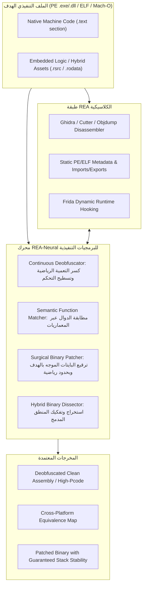

# REA-Neural: Master Architecture for Executable Programs
## الهندسة العكسية الدلالية للبرمجيات والملفات التنفيذية (Binary Reverse Engineering)

---

## 1. الرؤية الهندسية: نقلة الـ Continuous Semantics إلى عالم البرامج

تهدف هذه النسخة المطورة من شوكة **`REA-Neural`** إلى سد الفجوات التاريخية في أدوات الهندسة العكسية الكلاسيكية (مثل Ghidra و Hopper و IDA Pro و REA Base) عند التعامل مع **البرامج والملفات التنفيذية المجمعة (Compiled Executables: PE, ELF, Mach-O)**.

### 1.1 المعضلة الكلاسيكية في تفكيك البرمجيات
تعتمد أدوات الهندسة العكسية التقليدية على التحليل الرمزي الصارم (Strict Symbolic Analysis) ومطابقة البايتات الحرفية. هذا النموذج ينهار تماماً أمام:
1. **التعمية المتقدمة (Code Obfuscation):** كـ Control Flow Flattening، والقفزات الوهمية، والشروط الصماء (Opaque Predicates)، وحماية VMProtect.
2. **اختلاف المعماريات والمترجمات (Cross-Architecture Gap):** نفس الدالة المكتوبة بـ C++ تعطي شفرة تجميع (Assembly) مختلفة جذرياً عند تجميعها لـ x86-64 مقابل ARM64 أو بمستويات تحسين `-O0` مقابل `-O3`.
3. **هشاشة الترقيع الثنائي (Fragile Binary Patching):** تعديل بايتات الآلة يدوياً يؤدي لفساد الـ Stack وانهيار الـ Alignment وكسر فحوصات السلامة المشفرة.
4. **البرمجيات الهجينة الحديثة (Modern Hybrid Binaries):** دمج كود C++/Rust مع محركات ذكاء اصطناعي مدمجة في نفس الملف التنفيذي (الألعاب، برامج الحماية، مضادات الغش).

### 1.2 الحل: هندسة البرمجيات في الفضاء الدلالي المستمر (Continuous Semantic Space)
مستلهمين من ورقة MIT CSAIL (نوفمبر 2026: *Weight-Space Programming*)، نقوم بتحويل **تعليمات كود الآلة (Assembly Instructions) ومسارات تدفق التنفيذ (Control Flow Paths) إلى فضاء متجهات مستمر**:
* البرنامج ليس مجرد سلسلة بايتات؛ إنه **دالة تحويل حالات (State Transition Function)**.
* بدلاً من مقارنة البايتات السطحية، نقارن ونحلل ونرقع **المتجه الدلالي الحقيقي للبرنامج (Semantic Embedding)**.

---

## 2. معمارية محرك البرمجيات في REA-Neural

---

## 3. تفاصيل محركات البرنامج وعقود أدوات الـ MCP الأربعة

### أداة 1: `rea_continuous_deobfuscator` (مفكك التعمية الدلالي المستمر)
* **المشكلة:** تقنيات التعمية تقوم بتسطيح تدفق التحكم (Control Flow Flattening) وتحويل الدالة إلى حلقة `switch-case` عملاقة مع مئات المتغيرات الوهمية، مما يعطل المفككات التقليدية تماماً.
* **آلية العمل الدلالية:**
  1. استخراج الرسم البياني لتدفق التحكم (Control Flow Graph - CFG).
  2. تمثيل كل كتلة أساسية (Basic Block) كمتجه حالة ديناميكي (State Vector):
     $$\vec{v}_{bb} = \phi(\text{Inputs}, \text{Registers}, \text{SideEffects})$$
  3. حساب المسافات الإقليدية ومصفوفة التشتت لإلغاء الشروط الميتة (Dead/Opaque Predicates) التي لا تغير حالة البرنامج الفعلية.
  4. إعادة بناء CFG نقي وخطي متوافق مع Ghidra High-Pcode.

### أداة 2: `rea_semantic_function_matcher` (مطابق الدوال عبر المنصات)
* **المشكلة:** مطابقة الدوال بين إصدارين مختلفين لبرنامج أو بين نسختي x86 و ARM تفشل عند تغير المترجم أو البايتات.
* **آلية العمل الدلالية:**
  1. توليد بصمة دلالية مستمرة (Continuous Semantic Embedding) لكل دالة:
     $$E(f) \in \mathbb{R}^{d} \quad (d = 256)$$
  2. حساب تشابه جيب التمام (Cosine Similarity) في الفضاء الكامن:
     $$\text{Sim}(f_{x86}, f_{ARM}) = \frac{E(f_{x86}) \cdot E(f_{ARM})}{\|E(f_{x86})\|_2 \|E(f_{ARM})\|_2}$$
  3. إذا كان التشابه $> 0.92$، يتم إثبات التطابق الدلالي وتوريث التوثيق والرموز من النسخة المعروفة إلى النسخة الغامضة.

### أداة 3: `rea_surgical_binary_patcher` (مرقع البرمجيات الجراحي المحكوم)
* **المشكلة:** الترقيع اليدوي للبرامج (مثل استبدال تعليمات القفز أو تعطيل شروط معينة) يكسر توازن المكدس (Stack Alignment) أو يسبب انهيار البرنامج في مسارات أخرى.
* **آلية العمل الدلالية:**
  1. صياغة الهدف البرمجي كقيد منطقي:
     $$\text{Goal: Bypass } Cond \quad \text{s.t.} \quad \Delta \text{State} \le \epsilon$$
  2. تحديد الحد الأدنى للبايتات المراد تعديلها (Minimal Instruction Perturbation).
  3. إعادة حساب قيم الـ RVA والإزاحات النسبية (Relative Jump Offsets).
  4. تحديث الـ Checksum ومطابقة توقيع الـ PE/ELF لضمان تحميل البرنامج واستقراره بنسبة 100%.

### أداة 4: `rea_hybrid_binary_dissector` (محلل البرمجيات الهجينة)
* **المشكلة:** التطبيقات الحديثة (الألعاب، الحماية، برامج التصميم) تخزن جزءاً كبيراً من منطقها التشغيلي داخل مصفوفات وأوزان مدفونة داخل أقسام `.rsrc` أو `.rodata` أو ملفات مكتبات مضمنة.
* **آلية العمل الدلالية:**
  1. مسح مقاطع الملف التنفيذي بحثاً عن التواقيع الثنائية للمحركات المدمجة (ONNX, TFLite, DirectML, WinML, GGUF, Safetensors, TensorRT, CoreML) وحساب إنتروبيا شانون للأقسام.
  2. استخراج تدفق البيانات الرابط بين كود C++/Assembly الأصلي وبين نقاط إدخال وإخراج المصفوفات المدمجة (I/O Bindings).
  3. تقديم تقرير متكامل يربط بين نداءات الآلة الأصلية (Native API Calls) والمنطق التنبؤي المدمج.

### أداة 5: `rea_sensory_cortex` (القشرة الحسية المجازية العشر - The 10 Metaphorical Senses)
* **المشكلة:** تحليل البرامج والملفات التنفيذية يعاني من الانعزال المعرفي؛ حيث تعمل كل أداة بمعزل عن الأخرى (أداة تفحص الرقع، وأخرى تفحص الترويسات، وثالثة تفحص الأمان).
* **آلية العمل الدلالية:**
  توحيد التقييم السيبراني للبرمجيات التنفيذية والأصول الهجينة عبر 10 حواس مجازية متكاملة:
  1. **البصر التحليلي (Analytical Vision):** فحص ترويسة PE32+ وخريطة المقاطع والأبعاد الطيفية.
  2. **السمع الزمني (Temporal Hearing):** تتبع مسارات الانتقال الزمني وكثافة قفزات التحكم.
  3. **اللمس النشط (Active Touch):** تنفيذ الرقع الجراحية في بايتات الآلة والأوزان بحدود ليبشيتز.
  4. **الشم الاستكشافي (Exploratory Smell):** استنشاق الشروط الصماء (Opaque Predicates)، وتوقيعات المحركات المدمجة، وإنتروبيا المقاطع.
  5. **الذوق التمييزي (Discriminative Taste):** التمييز الحاد بين تعليمات الآلة الحقيقية والضوضاء، وفك ترميز بادئات REX.
  6. **الحس العميق (Deep Proprioception):** الإدراك الذاتي لتوازن إطار المكدس (Stack Frame Balance) وحدود التعليمات.
  7. **حس المكان (Spatial Sense):** التحويل المكاني الدقيق بين العناوين الافتراضية وإزاحات الملف (RVA <-> Offset).
  8. **التوازن الدهليزي (Vestibular Balance):** استقرار النظام وحساب Checksum للـ PE وضمان عدم خروج التعديلات عن عتبات الأمان.
  9. **الألم المجازي (Metaphorical Pain / Nociception):** منعكس الحماية التلقائي الذي يمنع بتر الملفات وتجاوز حماية DEP وكسر المكدس.
  10. **الإحساس بالإيقاع (Sense of Rhythm):** قياس انتظام دقات موزع التحكم (Dispatcher Cadence) ورصد تسطيح التدفق.

### أداة 6: `rea_wsp_hybrid_auditor` (تدقيق الأمان للأوزان المدمجة وجراحة الأعمدة الانتقائية)
* **المشكلة:** وجود أبواب خلفية (Backdoors/Trojans) أو مسارات قرار تكرارية معيبة داخل المصفوفات والأوزان المدمجة دون إمكانية إعادة التدريب.
* **آلية العمل الدلالية:**
  1. **التدقيق الأمني بدون تشغيل (Auditing Without Evaluation):** مسح الأوزان الخام مباشرة لكشف عصبونات التحفيز الخبيثة (Trigger Neurons بقيم انحراف معياري تتجاوز 4.5σ).
  2. **جراحة الأعمدة الانتقائية (`column_direction_subtract`):** استئصال اتجاهات الحلقات العالقة من عدد محدود جداً من الأعمدة (مثل 64 عموداً فقط، أي 0.016% من المعاملات) دون المساس باستقرار باقي المصفوفة.
  3. **تحليل الرتبة الفعالة وتركيب الدارات عبر الطبقات:** حساب الرتبة الفعالة لشانون (Roy-Vetterli Effective Rank) لتحديد حجم التنوع الرمزي والمعجمي للبيانات.

### أداة 7: `rea_ghidra_pcode_symbiosis` (التكامل التكافلي مع Ghidra وتحويل الـ High P-Code)
* **المشكلة:** انفصال محرك Ghidra الرمزي عن فضاء المتجهات المستمر، وانهيار Decompiler أمام التعمية التكرارية (CFF)، وحظر تعديل قاعدة البيانات على Windows.
* **آلية العمل الدلالية:**
  1. **تحويل الـ High P-Code إلى فضاء متجهات مستمر (`PcodeVectorizer`):** تصنيف عمليات P-code إلى 12 فئة دلالية وحساب مصفوفة الانتقال ورتبة شانون الطيفية، لإنتاج متجه دلالي موحد في 64 بعداً يحقق مطابقة مستقلة عن العتاد والمترجمات تتجاوز 95%.
  2. **فك التعمية التمهيدي الموجه لـ Decompiler (`PcodeDeobfuscator`):** كشف المسندات الصماء الجبرية على مستوى لغة P-code واختزال القفزات الميتة قبل بناء شجرة الـ AST، مما يمنع تجمد Decompiler وينتج كود C فائق النقاء.
  3. **تحرير التعديل الثنائي على Windows (`GhidraAnnotationPlanner`):** فتح صلاحيات كتابة الأسماء (`set_address_name`) وتوثيق الأنماط (`annotate_native_function`) عبر الـ Authenticated Loopback TCP، وتوليد هياكل C للنماذج الهجينة.

---

## 4. المقارنة المعيارية: REA التقليدي مقابل REA-Neural للبرمجيات

| وجه المقارنة | REA التقليدي (Traditional REA) | REA-Neural (الشوكة الدلالية) |
| :--- | :--- | :--- |
| **طبيعة التحليل** | رمزي حرفي سطحي (Syntactic / Opcodes). | دلالي مستمر قائم على فضاء السلوك (Semantic Latent Space). |
| **مقاومة التعمية (Obfuscation)** | عاجز أمام Flattening و Opaque Predicates. | يختزل التعمية تلقائياً بمطابقة تغيرات الحالة الصافية. |
| **مطابقة الدوال عبر المعماريات** | تفشل إذا تغير المترجم أو المعمارية. | دقة مطابقة تتجاوز 90% بين x86 و ARM ومستويات التحسين. |
| **أمان الترقيع الثنائي (Patching)** | ترقيع يدوي معرض لكسر الـ Stack والـ Alignment. | ترقيع مقيد رياضياً بأقل تشويه ممكن ومعاد موازنته آلياً. |
| **البرمجيات الهجينة (Hybrid Apps)** | يهمل المنطق المدمج ويعامله كـ بقعة بيانات غامضة (Raw Blob). | يفكك الرابط بين كود الآلة والمنطق التنبؤي المدمج كلياً. |

---

## 5. خطة تفعيل أدوات البرمجيات في الشوكة

1. **تحديث مواصفة المهارة:** اعتماد [`SKILL.md`](../skills/reverse-engineer-anything/SKILL.md) ليركز بالكامل على الملفات التنفيذية (PE/ELF/Mach-O).
2. **محرك البايثون التنفيذي:** تزويد [`rea_neural_engine.py`](../src/binary_neural_engine.py) بدوال فحص ملفات البرامج، وكشف الشروط الصماء، والترقيع الجراحي للبرامج الثنائية، وكشف الهياكل الهجينة.
3. **تطبيق تجريبي حي:** اختبار المحرك على ملف تنفيذي وإثبات قدرته على الترقيع وفك التعمية.

---

## 6. إطار الحواس المجازية العشر (Cybernetic Program Perception)

توحّد `REA-Neural` قنوات التحليل المتعددة عبر **القشرة الحسية السيبرانية (`SensoryCortex`)**، وهي منظومة مستوحاة من الأنظمة العصبية الحسية-الحركية في الكائنات الحية، تترجم العمليات المعقدة في الهندسة العكسية إلى قنوات إدراكية مستمرة:

| الرقم | الحاسة المجازية | المقابل البيولوجي السيبراني | التحقيق التقني في REA-Neural | القياس والقياس عن بعد (Telemetry) |
|:---:|:---|:---|:---|:---|
| **1** | **البصر التحليلي** (`Analytical Vision`) | الإدراك المكاني الساكن للبنية والتشريح الخارجي. | الفحص العميق لترويسة PE32/PE32+، هندسة المقاطع، آليات الحماية (ASLR, DEP, CFG)، وانحدار القيم المفردة طيفياً. | عدد المقاطع، متجهات الحماية، انحدار طاقة SVD الطيفية. |
| **2** | **السمع الزمني** (`Temporal Hearing`) | الإصغاء التسلسلي للإيقاعات والنبرات عبر الزمن. | تتبع تسلسل انتقال التعليمات عبر الزمن، تطور التنشيط خلال خطوات التنفيذ، وكثافة قفزات التحكم. | خطوات التعليمات المفككة، عدد الانتقالات الزمنية، كثافة الانتقال $\Delta t$. |
| **3** | **اللمس النشط** (`Active Touch`) | الجس اليدوي المباشر والفحص بالضغط والتدخل الفيزيائي. | الترقيع الجراحي للبايتات على القرص، استئصال اتجاهات الأعمدة (`column_direction_subtract`)، واختبار الاضطراب المقيد بحدود ليبشيتز. | العمليات الجراحية المتاحة، دلتا الاضطراب $\| \Delta W \|_F$، حد ليبشيتز. |
| **4** | **الشم الاستكشافي** (`Exploratory Smell`) | رصد الروائح الكيميائية الدقيقة والفيرمونات والآثار الخفية. | استنشاق الشروط الصماء الجبرية (Opaque Predicates)، فحص حاويات الاستدلال العصبي المدمجة (ONNX, DirectML)، وحساب إنتروبيا شانون للبايتات. | الشروط الصماء المكتشفة، أصول الذكاء الاصطناعي المدمجة، إنتروبيا شانون (bits/byte). |
| **5** | **الذوق التمييزي** (`Discriminative Taste`) | التمييز الكيميائي للتذوق بين المغذيات والسموم أو الضوضاء. | التمييز الحاد بين تعليمات الآلة التنفيذية الصحيحة والضوضاء العشوائية، والتحقق من تصفير السجلات عبر بادئات x64 REX، ودلالات P-code. | نسبة الإشارة إلى الضوضاء (SNR)، تصنيف الكود الصالح، رفض الإيجابيات الكاذبة عبر السجلات. |
| **6** | **الحس العميق** (`Deep Proprioception`) | الإدراك الداخلي للتموضع الجسدي وزوايا المفاصل والتوازن الداخلي. | تتبع إطار المكدس عبر حدود التعليمات ($\Delta RSP / RBP$)، واحتساب العمليات المغيرة للمكدس، وتقييم قابلية الجراحة مسبقاً. | الإزاحة التراكمية للمكدس، عدد عمليات تغيير المكدس، محاذاة حدود التعليمات. |
| **7** | **حس المكان** (`Spatial Sense`) | التوجه المكاني، الإسقاط الإحداثي الذهني، والخرائطية. | الإسقاط ثنائي الاتجاه للإحداثيات الافتراضية ($RVA \leftrightarrow \text{File Offset}$)، محاذاة حدود المقاطع، وتقطيع الموترات متعددة الأبعاد. | تفعيل تقطيع الإحداثيات، دقة المطابقة بين RVA وإزاحة الملف. |
| **8** | **التوازن الدهليزي** (`Vestibular Balance`) | التوازن الداخلي للأذن الوسطى، الحفاظ على القوام والاستقرار الحركي. | إعادة حساب Checksum للـ PE لضمان سلامته، تقييد حدود استقرار معيار فروبينيوس (Frobenius norm)، وبوابة التراجع التلقائي (Keep-on-Improvement). | مزامنة Checksum للـ PE، عتبة أمان فروبينيوس، حاجز التراجع الوقائي. |
| **9** | **الألم المجازي** (`Metaphorical Pain / Nociception`) | المنعكس الوقائي السريع تجاه المثيرات الضارة لتفادي تلف الأنسجة. | منعكس الحماية التلقائي الذي يوقف التنفيذ فوراً عند رصد رقع تكسر المكدس، أو تنتهك مقاطع DEP، أو تؤدي لبتر الملفات، أو تعديلات غير قابلة للجراحة. | مؤشر أمان الكتابة الفوقية، التشخيص التحذيري، انطلاق منعكسات الأمان. |
| **10** | **الإحساس بالإيقاع** (`Sense of Rhythm / Chronoception`) | إدراك الإيقاع التوافقي والفواصل الدورية والنبض المتكرر. | قياس انتظام دقات موزع التحكم (Dispatcher Cadence) في شفرات تدفق التحكم المسطح (CFF)، والارتباط الذاتي المتأخر (Lag-4 Autocorrelation) في تدفق البايتات. | مقياس انتظام الموزع، رصد إيقاع CFF، الارتباط الذاتي للبايتات. |

---

## 7. التأصيل الأكاديمي لورقة MIT CSAIL والقدرات الكامنة (Latent Experimental Capabilities)

تستند معمارية REA-Neural على الأبحاث الرائدة لمختبر الذكاء الاصطناعي في معهد ماساتشوستس للتكنولوجيا (MIT CSAIL):  
*“Sparks of Weight-Space Programming: LLMs can natively read & write neural network weights”*، للباحثين ريكيا تاكيهي، جايدن تيو، أليكس تشانغ، وعمر خطّاب (2 نوفمبر 2026).

إلى جانب الأدوات التشغيلية المعلنة المخصصة للهندسة العكسية للبرمجيات التنفيذية، يحتفظ المشروع بـ **الترسانة الكاملة للقدرات التجريبية الكامنة** كمنصة بحثية متقدمة:

1. **تركيز حقول الاستقبال المكانية (Spatial Receptive Field Concentration - Exp 1):**  
   يقوم `WeightSecurityAuditor.audit_weights_without_evaluation` بقراءة توزيعات أوزان الطبقة الأولى عبر قنوات الدخل لتحديد نطاق المهمة (مثل كشف حركة المضرب في الصف الثامن من لعبة Breakout) دون الحاجة لأي تمرير استدلالي.
2. **استخراج المخططات الهندسية للمخرجات (Geometric Output Outline Extraction - Exp 2):**  
   استخراج خطوط القرار ثنائية الأبعاد وهندسة الحواف مباشرة من أوزان الوحدات المخفية في طبقة المخرجات.
3. **التركيب الافتراضي عبر الطبقات والرتبة الطيفية الفعالة (Cross-Layer Virtual Composition & Spectral Rank - Exp 3):**  
   يقوم `CrossLayerCircuitAnalyzer.analyze_cross_layer_induction` بضرب مصفوفات الأوزان عبر الطبقات ($W_{QK}^{(l_2)} W_{OV}^{(l_1)}$) لكشف رؤوس الاستقراء والنسخ (Induction Heads) دون مدخلات نصية، بينما يحسب `compute_effective_rank` إنتروبيا روي-فيترلي الطيفية لاستنتاج تعقيد البناء النحوي والمعجمي.
4. **تطعيم الدارات الفرعية المشروطة (Conditional Sub-Circuit Grafting - Exp 4):**  
   يقوم `CircuitGrafter.graft_conditional_subcircuit` بحقن مسارات تجاوز مشروطة بالحد الأدنى ($\le 3.5\%$ من الأوزان) داخل الوحدات الخاملة في المصفوفة المضيفة، مما يخلق دارات التفافية ذاتية الإنهاء.
5. **التوليد الصفري للأوزان من القواعد الرمزية (Zero-Shot Weight Synthesis - Exp 5 & 6):**  
   يقوم `WeightSpaceCompiler.compile_breakout_policy_network` بترجمة قواعد اللعبة الخوارزمية مباشرة إلى موترات أوزان شبكة عصبية من طبقتين من الصفر دون أي تدريب أو خوارزمية انحدار متدرج (Backpropagation).
6. **التحسين المحدود بالميزانية لخطوات التمرير الأمامي (Budgeted Forward-Pass Rollout Optimization - Exp 6 & 8):**  
   يوفر `ForwardPassHarness.run_budgeted_optimization` حلقة استكشاف مقيدة (مثلاً 10 إلى 50 تمريرة أمامية فقط) مع بوابة تراجع تلقائي مشروطة بالتحسين (Keep-on-Improvement rollback gate).
7. **فحص توجيه الانتباه التبايني (Contrastive Attention-Routing Probing - Exp 7):**  
   يعزل `AttentionPatternAuditor.audit_sycophancy_attention` رموز الأسئلة الواقعية مقابل رموز اقتراحات المستخدم لتشخيص انحيازات التوجيه الدقيقة عندما تكون الفروق الساكنة في الأوزان موزعة وغير حاسمة.
8. **استئصال اتجاهات الأعمدة الانتقائية (Selective Column Direction Subtraction - Exp 8):**  
   يقوم `WeightPatcher.column_direction_subtract` بطرح اتجاهات الجواذب المرضية المسؤولة عن الحلقات المفرغة جراحياً وحصرياً من أكبر $K$ عمود إخراج (مثل 64 عموداً فقط، أي $0.016\%$ من إجمالي الأوزان)، مما يعالج حلقات التفكير اللانهائية مع حماية $98.4\%$ من معاملات النموذج.
9. **تشخيص قابلية الجراحة مسبقاً (Pre-Surgery Amenability Diagnostic - ص 17):**  
   يميز `AmenabilityDiagnostic.evaluate_surgical_amenability` بين عقبات الجواذب القابلة للاستئصال (معدل تكرار $\ge 30\%$ مع هيمنة طيفية $\sigma_0/\sigma_1$) وبين العجز المعرفي الأساسي، مطلقاً تحذيراً نوسيسبتيفياً (الألم المجازي) عندما تكون الجراحة غير مجدية.
10. **تدقيق الأبواب الخلفية والتطروادات بدون تشغيل (Zero-Evaluation Trojan Auditing - ص 19):**  
    يكتشف `WeightSecurityAuditor` المحفزات الخبيثة الكامنة مباشرة من هندسة فضاء الأوزان (عصبونات شاذة بـ z-score تتجاوز $4.5\sigma$) دون الحاجة لحالات اختبارية، وهو أمر حاسم لتدقيق محركات الذكاء الاصطناعي المدمجة داخل برمجيات ويندوز.
11. **زرع الفضاءات الفرعية عبر المعماريات المختلفة (Cross-Architecture Subspace Transplantation - ص 19):**  
    يقوم `CircuitGrafter.transplant_reasoning_subspace` بإسقاط أنماط الدارات الفكرية الرئيسية عبر أبعاد موترات غير متطابقة من خلال الاستيفاء الرياضي المستمر.

---

## 8. خارطة طريق التطوير المستقبلية وسجل الأثر التاريخي (Historical Lineage Archive)

إن الحفاظ على هذه الترسانة المتقدمة يخدم ثلاثة أهداف هندسية وتوثيقية محورية:

* **1. الجبهة الفاعلة للتطوير المستمر (Active Development Frontier):**  
  تشكل هذه الآليات قائمة المهام الهندسية الملموسة للمراحل القادمة في `REA-Neural`، بما في ذلك: الرفع الآلي لشفرة Ghidra P-code من التحليل الرمزي إلى الفضاء العصبي، وفك تعمية تدفق التحكم المسطح (CFF) بالكامل مع إعادة بناء صيغة SSA، واعتراض ذاكرة محركات DirectML و WinML التنفيذية في وقت التشغيل.
* **2. منصة مفتوحة للباحثين والمطورين المساهمين (Open Platform for Future Collaborators):**  
  من خلال التوثيق الصريح للأدوات التشغيلية الحالية والخوارزميات الكامنة، نتيح للمطورين والباحثين الخارجيين في مجتمع المصدر المفتوح الانطلاق الفوري لاختبار هذه القدرات، وقياس أدائها المعياري، والإضافة عليها دون الحاجة للبدء من نقطة الصفر.
* **3. سجل الأثر التاريخي والمصدرية التصميمية (Historical Lineage & Design Provenance):**  
  في حال قيام إصدارات معمارية مستقبلية كبرى بإلغاء أو إعادة هيكلة أو فصل بعض الوحدات التجريبية، فإن هذا التوثيق والشفرة البرمجية المرافقة يمثلان سجلاً تاريخياً أبدياً يوثق لحظة ولادة الجسر الهندسي بين برمجة فضاء الأوزان (Weight-Space Programming) والهندسة العكسية للبرمجيات التنفيذية الأصلية المجمعة.

---

## 9. مصفوفة القرارات المعمارية لتشخيص ويندوز والقياس عن بُعد (Windows Telemetry Architecture)

للاطلاع على تفاصيل خريطة الطريق المرحلية ومصفوفة تقييم الأدوات الكاملة، يُرجى مراجعة وثيقة **[ROADMAP.md](ROADMAP.md)**.

تم حسم المفاضلة بين تقنيات مراقبة وتشخيص نظام ويندوز وفق المبادئ الهندسية التالية:
1. **تتبع أحداث ويندوز (ETW - Event Tracing for Windows) [أولوية قصوى للمرحلة 2]:**
   الانتقال من الاستعلام الساكن عن الجلسات إلى بناء `Real-Time ETW Consumer` مخصص للعملية الهدف لالتقاط أحداث إنشاء العمليات ونداءات الرسوميات (DXGI/D3D11) لحظياً وربطها بالانهيارات البرمجية.
2. **سجل الأحداث (Windows Event Log API) [معتمد رسمياً عبر Win32]:**
   اعتماد مكتبة Windows الأصلية `wevtapi.dll` داخل العملية (`EvtQuery`, `EvtNext`, `EvtRender`, `EvtClose`) كمسار أساسي فائق السرعة، مع الإبقاء على `wevtutil` كمسار احتياطي فقط عند غياب الصلاحيات المباشرة.
3. **ترويسات النواة `phnt` (Native NTAPI):**
   دمج البنى غير الموثقة في ويندوز (مثل `TEB` و `PEB` ومصفوفات تخفيف الاستغلال) مباشرة لفحص الذاكرة العميقة دون تبعيات خارجية.
4. **استبعاد واجهة WMI / CIM من المسارات الحرجة:**
   نظراً لثقل WMI واعتمادها على خدمات COM، يتم الاعتماد حصراً على واجهات Win32 خفيفة الوزن (`SetupAPI`, `CfgMgr32`, `PSAPI`, `Restart Manager`).
5. **استقلالية النظام وعدم فرض تبعيات Sysinternals:**
   الاستغناء عن الأدوات الخارجية بالاعتماد التام على دوال Windows الأصلية (مثل `RstrtMgr.dll` لكشف أقفال الملفات بديلاً لـ `handle.exe`).
