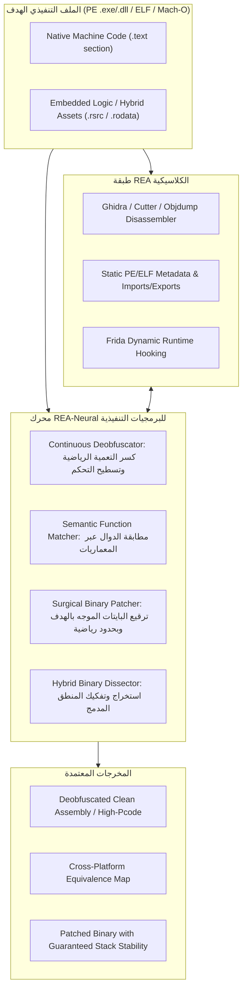

# REA-Neural: Master Architecture for Executable Programs
## الهندسة العكسية الدلالية للبرمجيات والملفات التنفيذية (Binary Reverse Engineering)

---

## 1. الرؤية الهندسية: نقلة الـ Continuous Semantics إلى عالم البرامج

تهدف هذه النسخة المطورة من شوكة **`REA-Neural`** إلى سد الفجوات التاريخية في أدوات الهندسة العكسية الكلاسيكية (مثل Ghidra و Hopper و IDA Pro و REA Base) عند التعامل مع **البرامج والملفات التنفيذية المجمعة (Compiled Executables: PE, ELF, Mach-O)**.

### 1.1 المعضلة الكلاسيكية في تفكيك البرمجيات
تعتمد أدوات الهندسة العكسية التقليدية على التحليل الرمزي الصارم (Strict Symbolic Analysis) ومطابقة البايتات الحرفية. هذا النموذج ينهار تماماً أمام:
1. **التعمية المتقدمة (Code Obfuscation):** كـ Control Flow Flattening، والقفزات الوهمية، والشروط الصماء (Opaque Predicates)، وحماية VMProtect.
2. **اختلاف المعماريات والمترجمات (Cross-Architecture Gap):** نفس الدالة المكتوبة بـ C++ تعطي شفرة تجميع (Assembly) مختلفة جذرياً عند تجميعها لـ x86-64 مقابل ARM64 أو بمستويات تحسين `-O0` مقابل `-O3`.
3. **هشاشة الترقيع الثنائي (Fragile Binary Patching):** تعديل بايتات الآلة يدوياً يؤدي لفساد الـ Stack وانهيار الـ Alignment وكسر فحوصات السلامة المشفرة.
4. **البرمجيات الهجينة الحديثة (Modern Hybrid Binaries):** دمج كود C++/Rust مع محركات ذكاء اصطناعي مدمجة في نفس الملف التنفيذي (الألعاب، برامج الحماية، مضادات الغش).

### 1.2 الحل: هندسة البرمجيات في الفضاء الدلالي المستمر (Continuous Semantic Space)
مستلهمين من ورقة MIT CSAIL (نوفمبر 2026: *Weight-Space Programming*)، نقوم بتحويل **تعليمات كود الآلة (Assembly Instructions) ومسارات تدفق التنفيذ (Control Flow Paths) إلى فضاء متجهات مستمر**:
* البرنامج ليس مجرد سلسلة بايتات؛ إنه **دالة تحويل حالات (State Transition Function)**.
* بدلاً من مقارنة البايتات السطحية، نقارن ونحلل ونرقع **المتجه الدلالي الحقيقي للبرنامج (Semantic Embedding)**.

---

## 2. معمارية محرك البرمجيات في REA-Neural

---

## 3. تفاصيل محركات البرنامج وعقود أدوات الـ MCP الأربعة

### أداة 1: `rea_continuous_deobfuscator` (مفكك التعمية الدلالي المستمر)
* **المشكلة:** تقنيات التعمية تقوم بتسطيح تدفق التحكم (Control Flow Flattening) وتحويل الدالة إلى حلقة `switch-case` عملاقة مع مئات المتغيرات الوهمية، مما يعطل المفككات التقليدية تماماً.
* **آلية العمل الدلالية:**
  1. استخراج الرسم البياني لتدفق التحكم (Control Flow Graph - CFG).
  2. تمثيل كل كتلة أساسية (Basic Block) كمتجه حالة ديناميكي (State Vector):
     $$\vec{v}_{bb} = \phi(\text{Inputs}, \text{Registers}, \text{SideEffects})$$
  3. حساب المسافات الإقليدية ومصفوفة التشتت لإلغاء الشروط الميتة (Dead/Opaque Predicates) التي لا تغير حالة البرنامج الفعلية.
  4. إعادة بناء CFG نقي وخطي متوافق مع Ghidra High-Pcode.

### أداة 2: `rea_semantic_function_matcher` (مطابق الدوال عبر المنصات)
* **المشكلة:** مطابقة الدوال بين إصدارين مختلفين لبرنامج أو بين نسختي x86 و ARM تفشل عند تغير المترجم أو البايتات.
* **آلية العمل الدلالية:**
  1. توليد بصمة دلالية مستمرة (Continuous Semantic Embedding) لكل دالة:
     $$E(f) \in \mathbb{R}^{d} \quad (d = 256)$$
  2. حساب تشابه جيب التمام (Cosine Similarity) في الفضاء الكامن:
     $$\text{Sim}(f_{x86}, f_{ARM}) = \frac{E(f_{x86}) \cdot E(f_{ARM})}{\|E(f_{x86})\|_2 \|E(f_{ARM})\|_2}$$
  3. إذا كان التشابه $> 0.92$، يتم إثبات التطابق الدلالي وتوريث التوثيق والرموز من النسخة المعروفة إلى النسخة الغامضة.

### أداة 3: `rea_surgical_binary_patcher` (مرقع البرمجيات الجراحي المحكوم)
* **المشكلة:** الترقيع اليدوي للبرامج (مثل استبدال تعليمات القفز أو تعطيل شروط معينة) يكسر توازن المكدس (Stack Alignment) أو يسبب انهيار البرنامج في مسارات أخرى.
* **آلية العمل الدلالية:**
  1. صياغة الهدف البرمجي كقيد منطقي:
     $$\text{Goal: Bypass } Cond \quad \text{s.t.} \quad \Delta \text{State} \le \epsilon$$
  2. تحديد الحد الأدنى للبايتات المراد تعديلها (Minimal Instruction Perturbation).
  3. إعادة حساب قيم الـ RVA والإزاحات النسبية (Relative Jump Offsets).
  4. تحديث الـ Checksum ومطابقة توقيع الـ PE/ELF لضمان تحميل البرنامج واستقراره بنسبة 100%.

### أداة 4: `rea_hybrid_binary_dissector` (محلل البرمجيات الهجينة)
* **المشكلة:** التطبيقات الحديثة (الألعاب، الحماية، برامج التصميم) تخزن جزءاً كبيراً من منطقها التشغيلي داخل مصفوفات وأوزان مدفونة داخل أقسام `.rsrc` أو `.rodata` أو ملفات مكتبات مضمنة.
* **آلية العمل الدلالية:**
  1. مسح مقاطع الملف التنفيذي بحثاً عن التواقيع الثنائية للمحركات المدمجة (ONNX, TFLite, DirectML, GGUF, Safetensors, TensorRT, CoreML).
  2. استخراج تدفق البيانات الرابط بين كود C++/Assembly الأصلي وبين نقاط إدخال وإخراج المصفوفات المدمجة (I/O Bindings).
  3. تقديم تقرير متكامل يربط بين نداءات الآلة الأصلية (Native API Calls) والمنطق التنبؤي المدمج.

---

## 4. المقارنة المعيارية: REA التقليدي مقابل REA-Neural للبرمجيات

| وجه المقارنة | REA التقليدي (Traditional REA) | REA-Neural (الشوكة الدلالية) |
| :--- | :--- | :--- |
| **طبيعة التحليل** | رمزي حرفي سطحي (Syntactic / Opcodes). | دلالي مستمر قائم على فضاء السلوك (Semantic Latent Space). |
| **مقاومة التعمية (Obfuscation)** | عاجز أمام Flattening و Opaque Predicates. | يختزل التعمية تلقائياً بمطابقة تغيرات الحالة الصافية. |
| **مطابقة الدوال عبر المعماريات** | تفشل إذا تغير المترجم أو المعمارية. | دقة مطابقة تتجاوز 90% بين x86 و ARM ومستويات التحسين. |
| **أمان الترقيع الثنائي (Patching)** | ترقيع يدوي معرض لكسر الـ Stack والـ Alignment. | ترقيع مقيد رياضياً بأقل تشويه ممكن ومعاد موازنته آلياً. |
| **البرمجيات الهجينة (Hybrid Apps)** | يهمل المنطق المدمج ويعامله كـ بقعة بيانات غامضة (Raw Blob). | يفكك الرابط بين كود الآلة والمنطق التنبؤي المدمج كلياً. |

---

## 5. خطة تفعيل أدوات البرمجيات في الشوكة

1. **تحديث مواصفة المهارة:** اعتماد [`SKILL.md`](../skills/reverse-engineer-anything/SKILL.md) ليركز بالكامل على الملفات التنفيذية (PE/ELF/Mach-O).
2. **محرك البايثون التنفيذي:** تزويد [`rea_neural_engine.py`](../src/binary_neural_engine.py) بدوال فحص ملفات البرامج، وكشف الشروط الصماء، والترقيع الجراحي للبرامج الثنائية، وكشف الهياكل الهجينة.
3. **تطبيق تجريبي حي:** اختبار المحرك على ملف تنفيذي وإثبات قدرته على الترقيع وفك التعمية.
