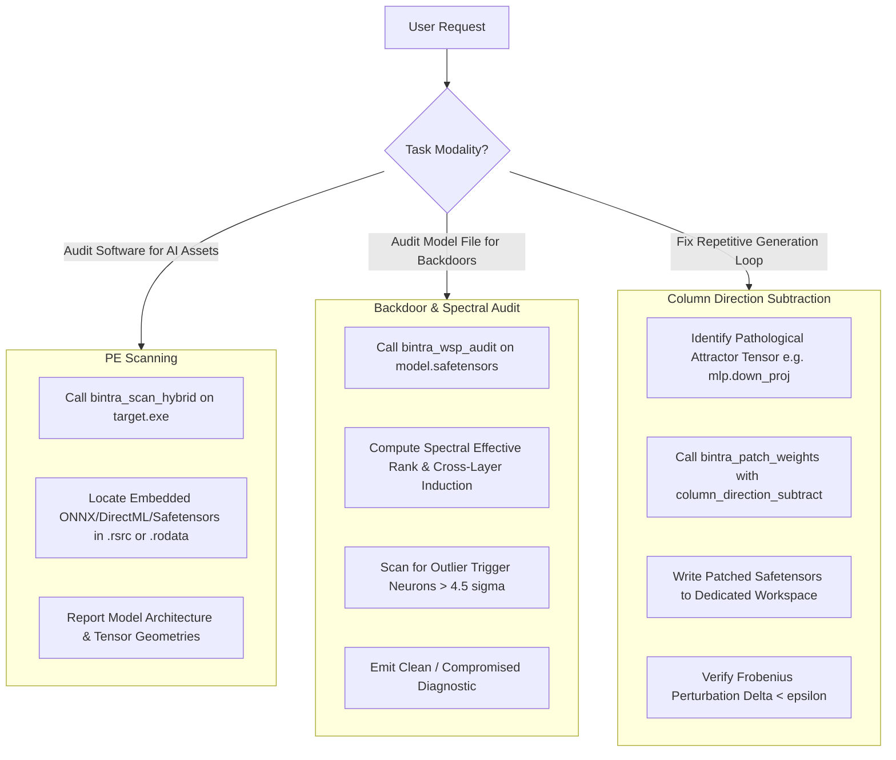

# Bintra: Weight Security & Safetensors Surgery Skill

Use this skill whenever an AI coding agent or user needs to audit embedded AI models, inspect `.safetensors` weight matrices, detect hidden backdoors/trojans, or fix pathological looping without running costly backpropagation or training pipelines.

---

## 1. When to Activate This Skill

Activate this skill when the user asks:
- *"Scan this Windows application (`.exe`) to see if it embeds an AI model (ONNX, DirectML, GGUF, Safetensors)."*
- *"Audit this `.safetensors` file without running forward passes."*
- *"Check if this neural model has backdoors or dormant trojan trigger neurons."*
- *"The model is stuck generating repetitive infinite text / reasoning loops. Can we fix the weights?"*
- *"Compute the spectral effective rank or cross-layer composition of these attention matrices."*
- *"Apply selective column direction subtraction to eliminate a loop attractor."*

---

## 2. Theoretical Grounding (MIT CSAIL Weight-Space Programming)

This skill operationalizes recent breakthroughs from MIT CSAIL (*"Sparks of Weight-Space Programming"*, Takehi, Teoh, Zhang, Khattab, 2026):

1. **Zero-Execution Weight Auditing:**
   Weights can be inspected directly as spatial representations:
   - **First-Layer Receptive Fields:** Expose the model's perceptual focus directly from weight norms.
   - **Spectral Effective Rank:** Evaluates singular value entropy ($H(\mathbf{p})$) to measure model expressive capacity without tokens.
   - **Backdoor / Trojan Outliers:** Maliciously grafted trigger neurons exhibit extreme norm z-scores ($> 4.5\sigma$) relative to the background weight distribution.
2. **Selective Column Direction Subtraction:**
   Pathological loop attractors (repetitive loops) concentrate along specific singular projection directions. Rather than fine-tuning with gradients, Bintra subtracts the loop vector exclusively from the top-$K$ most active columns (e.g., 64 columns; $\approx 0.016\%$ of weights), curing the loop while leaving $98.4\%$ of parameters untouched.

---

## 3. Operational Workflow



---

## 4. Tool Invocations: MCP vs CLI

### Task A: Scanning an Executable for Embedded AI Models

**MCP Tool:**
```json
{
  "name": "bintra_scan_hybrid",
  "arguments": {
    "file_path": "C:\\path\\to\\application.exe"
  }
}
```

**CLI Command:**
```powershell
bintra scan-hybrid --file "C:\path\to\application.exe"
```

---

### Task B: Zero-Evaluation Backdoor & Spectral Audit

**MCP Tool:**
```json
{
  "name": "bintra_wsp_audit",
  "arguments": {
    "model_path": "C:\\path\\to\\model.safetensors"
  }
}
```

**CLI Command:**
```powershell
bintra wsp-audit --model "C:\path\to\model.safetensors"
```

**Key Diagnostic Output Keys (`bintra_wsp_audit` / `wsp-audit`):**
- `effective_rank_analysis.effective_rank` (plus `.participation_ratio`, `.max_possible_rank`, `.inferred_domain_profile`): Spectral entropy measure of weight diversity.
- `zero_eval_security_audit.potential_backdoor_detected` (plus `.max_neuron_norm_zscore`, `.suspect_trigger_neurons`): Heuristic flag checking two conditions ($> 4.5\sigma$ row/neuron norm outlier **and** elevated spike concentration); benign dense outliers in normalization/outlier channels can elevate z-scores and require inspecting `suspect_trigger_neurons` before concluding malicious compromise.
- `surgical_amenability.is_amenable_to_weight_surgery` (plus `.wsp_prognosis`, `.recommended_num_columns`, `.spectral_dominance_ratio`): Assesses whether the model is amenable to localized column intervention vs capability deficit.
- `cross_layer_induction.copying_heads_detected` / `.copying_head_density` (when 2+ tensors exist): Cross-layer induction alignment metrics.

---

### Task C: Curing Pathological Loops via Column Direction Subtraction

> [!IMPORTANT]
> **Workspace Confinement:** Always write the patched safetensors model to a dedicated workspace folder outside the source directory!

**MCP Tool:**
```json
{
  "name": "bintra_patch_weights",
  "arguments": {
    "source_path": "C:\\models\\llama_base.safetensors",
    "output_path": "C:\\workspace\\llama_cured.safetensors",
    "tensor_name": "model.layers.15.mlp.down_proj.weight",
    "num_columns": 64
  }
}
```

**CLI Command:**
```powershell
bintra patch-weights `
  --source "C:\models\llama_base.safetensors" `
  --output ".\workspace\llama_cured.safetensors" `
  --tensor "model.layers.15.mlp.down_proj.weight" `
  --operation column_direction_subtract `
  --num-columns 64
```

**Additional Weight-Space CLI Diagnostics (`bintra`):**
- `bintra subspace --model <m> --tensor <t> [--mode svd_modes|sparse_extremes|coordinate_slice]`
- `bintra decompile --model <m> --tensor <t> [--circuit-type attention_head|mlp_projection|layer_norm_drift]`
- `bintra diff-weights --baseline <orig> --patched <new> --tensor <t>` (`frobenius_relative_shift`, `is_within_safety_bound`)
- `bintra probe-trace --model <m> --prompt "<text>"` (seeded SVD operator simulation)
- `bintra verify-behavior --baseline <orig> --patched <new>` (`is_equilibrium_preserved`, `max_frobenius_relative_shift`)

**Output Keys (`bintra_patch_weights` / `patch-weights`):**
- `output_path`, `output_sha256`, `patched_tensor_names`: Patched workspace artifact and integrity digest.
- `metrics.modified_percentage` (`metrics.modified_elements` / `metrics.total_elements`): Percentage of parameters altered.
- `metrics.frobenius_energy_shift_ratio`, `metrics.lipschitz_spectral_bound`, `metrics.is_within_safety_bound`: Spectral perturbation bounds ($< 0.005$ target).
- **Behavioral Verification Caveat:** There is no static `is_loop_cured` boolean returned by patching itself; verify attractor attenuation afterward with `bintra diff-weights` and `bintra verify-behavior` (and real downstream model evaluation where applicable).
