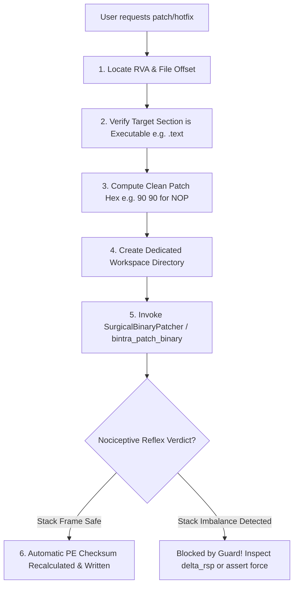

# Bintra: Safe Surgical Binary Patching Skill

Use this skill whenever an AI coding agent or user needs to modify bytes, NOP out instructions, bypass conditional jumps, or inject hotfixes into a Windows executable (`.exe`, `.dll`) on disk.

---

## 1. Absolute Guardrails for AI Agents (MUST FOLLOW)

The Bintra **Safety Kernel & Execution Guard** strictly enforces complete mediation and fail-closed security. Any violation will instantly abort the operation:

> [!CAUTION]
> **RULE 1: TARGET IMMUTABILITY (NO IN-PLACE PATCHING)**  
> Never attempt to modify or overwrite the source binary in-place. Passing `file_path == output_path` will immediately trigger `TargetMutationError(TARGET_WRITE_FORBIDDEN)`.

> [!WARNING]
> **RULE 2: STRICT WORKSPACE CONFINEMENT**  
> Output binaries MUST be written to an isolated, dedicated workspace directory (e.g. `./workspace/target_patched.exe` or `C:\path\to\workspace\patched.exe`). Writing inside the target's original directory triggers `TARGET_DIRECTORY_WRITE_FORBIDDEN`.

> [!IMPORTANT]
> **RULE 3: NOCICEPTIVE STACK BALANCE REFLEX**  
> Bintra tracks stack frame alignment ($\Delta RSP / RBP$). If your patch injects stack-altering instructions (like `sub rsp, 0x28` or unaligned `push`/`pop`) over neutral code, the engine's **Nociceptive Reflex** will block execution with `RuntimeError: Stack frame balance violated` to protect the host OS from silent corruption.

---

## 2. Operational Decision Tree



---

## 3. Tool Invocations: MCP vs CLI

### Modality A: Agent MCP Tool

Use the `bintra_patch_binary` tool:

```json
{
  "name": "bintra_patch_binary",
  "arguments": {
    "file_path": "C:\\path\\to\\original\\target.exe",
    "output_path": "C:\\path\\to\\workspace\\target_patched.exe",
    "offset": 4160,
    "patch_hex": "90 90 90 90 90",
    "force": false
  }
}
```

**Key Parameters:**
- `file_path` (string, required): Absolute path to the immutable source executable.
- `output_path` (string, required): Output destination path in an authorized workspace. Must NOT be inside the source directory.
- `offset` (integer, required): 0-based file byte offset where the patch begins.
- `patch_hex` (string, required): Hex string of bytes to write (e.g. `"90 90"` for two NOP instructions, `"EB 05"` for short relative JMP).
- `force` (boolean, optional): If `true`, overrides the nociceptive stack frame warning.

### Modality B: Unified CLI (`bintra`)

```powershell
# 1. Create a segregated workspace folder
mkdir workspace -Force

# 2. Surgically patch an instruction (e.g., NOP out a conditional jump at offset 0x1A40)
bintra patch-binary `
  --file "C:\path\to\target.exe" `
  --output ".\workspace\target_patched.exe" `
  --offset 0x1A40 `
  --patch-hex "90 90"

# 3. Verify the patched binary integrity
bintra inspect --file ".\workspace\target_patched.exe"
```

---

## 4. Common Assembly Patch Patterns

When vibe-coding patches for the user, use these canonical, stack-safe patterns:

| Desired Behavior | Original Machine Code | Safe Replacement Patch | Explanation |
|:---|:---|:---|:---|
| **Disable Check / Function (NOP)** | `74 08` (`jz +8`) or `E8 ...` (`call`) | `90 90` (or matching NOP count) | Neutralizes the instruction; preserves surrounding code. |
| **Always Jump (Force Branch)** | `74 12` (`jz +18`) | `EB 12` (`jmp +18`) | Changes conditional jump to an unconditional short jump (preserve relative displacement; short Jcc rel8 vs near rel32 lengths differ). |
| **Never Jump (Skip Branch)** | `75 0A` (`jnz +10`) | `90 90` | Replaces the 2-byte branch with two NOPs. |
| **Return Early (Function Entry)** | `55 48 89 E5 ...` | `31 C0 C3` (`xor eax, eax; ret`) | Returns 0 at function entry **before** stack frame setup (`push rbp; mov rbp, rsp`); patching after prologue setup requires matching epilogue teardown. |

> [!NOTE]
> **Heuristic Scope Caveat:** Stack balance checking (`RSP` / `RBP` proprioception) validates local replacement instructions heuristically; it does not perform full inter-procedural calling-convention or branch-target relocation verification. Always re-inspect relative jump targets and test patched workspace binaries in an isolated sandbox.

---

## 5. Post-Patch Verification Checklist

After `bintra_patch_binary` or `patch-binary` completes, inspect these exact returned fields:
1. `is_safe` / `is_stack_safe`: `true` (heuristic stack balance guard passed).
2. `pe_checksum_recalculated` & `new_pe_checksum`: `true` and updated PE header checksum hex.
3. `original_sha256` & `patched_sha256`: Distinct digests confirming source binary remained untouched (`Safety Kernel` `source_file` immutability).
4. `output_file`: Destination path inside the authorized workspace directory (alongside `file_offset`, `virtual_rva`, `target_section`, and `is_in_executable_section`).
