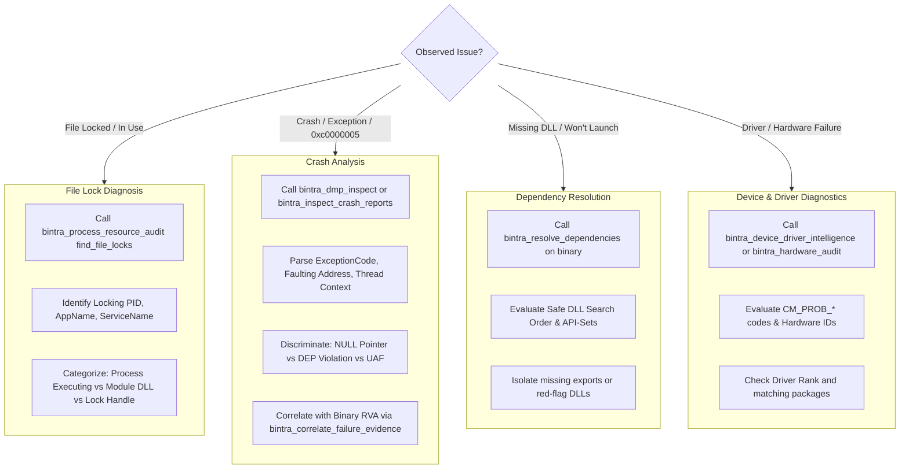

# Bintra: Windows System Forensics & Troubleshooting Skill

Use this skill whenever a user reports that a Windows program is crashing, freezing, failing to start, locked by a mystery process, or suffering from driver/dependency conflicts.

---

## 1. When to Activate This Skill

Activate this skill when the user asks:
- *"Why is this desktop application crashing on launch?"*
- *"I am getting error `0xc0000005` (Access Violation). What does it mean and where is it crashing?"*
- *"This file / DLL is locked and cannot be replaced or deleted. Which process is locking it?"*
- *"Check this crash dump (`.dmp`) file."*
- *"Why can't Windows find this DLL or API-Set (`api-ms-win-*`)?"*
- *"Why is this device driver failing with Code 43, Code 10, or Code 28?"*
- *"Show me which processes are currently hosting `d3d11.dll` or `app_plugin64.dll`."*

---

## 2. Operational Troubleshooting Matrix



---

## 3. Tool Invocations: MCP vs CLI

### Task A: Discovering File Locks (Without Killing Processes)

Instead of using brute-force tools, Bintra leverages the native **Windows Restart Manager API**:

**MCP Tool:**
```json
{
  "name": "bintra_process_resource_audit",
  "arguments": {
    "action": "find_file_locks",
    "file_path": "C:\\Program Files\\App\\resource.dll"
  }
}
```

**CLI Command:**
```powershell
bintra file-locks --file "C:\Program Files\App\resource.dll"
```

**Output Keys (`usage_breakdown` & `locking_processes`):**
- `is_locked`, `resource_state`, `usage_classifications`, `locking_processes_count`.
- Inside `usage_breakdown`: `is_actively_executing`, `is_loaded_as_dll`, `has_restart_manager_handle`, `has_exclusive_lock`.
- Inside each entry of `locking_processes`: `process_id`, `application_name`, `service_name`, `is_restartable`.

**All 5 Supported `bintra_process_resource_audit` Actions:**
- `find_file_locks` (requires `file_path`)
- `find_module_holders` (requires `module_query`; CLI: `bintra proc-modules --module <dll>`)
- `process_tree` (full running process inventory and parent-child hierarchy)
- `service_process_map` (maps running SCM services to host PIDs)
- `audit_process` (detailed process inspection for `pid`)

---

### Task B: Finding Processes Hosting a Specific DLL

**MCP Tool:**
```json
{
  "name": "bintra_process_resource_audit",
  "arguments": {
    "action": "find_module_holders",
    "module_query": "d3d12.dll"
  }
}
```

**CLI Command:**
```powershell
bintra proc-modules --module d3d12.dll
```

---

### Task C: Diagnosing 0xc0000005 & MiniDump (.dmp) Crashes

**MCP Tool:**
```json
{
  "name": "bintra_dmp_inspect",
  "arguments": {
    "dmp_path": "C:\\Users\\User\\AppData\\Local\\CrashDumps\\app.exe.1234.dmp"
  }
}
```

**CLI Command:**
```powershell
bintra dmp-inspect --file "C:\path\to\crash.dmp"
```

**How to Interpret the Root Cause for the User (`exception_info`):**
- `exception_info.is_null_pointer_dereference`: The app attempted to read/write address `< 0x10000` (e.g. `[rax+0x18]` where `rax=0`). Inspect `access_type` / `operation` and `exception_address`.
- `exception_info.access_type` (and `operation`): When `0xc0000005` shows `"EXECUTE"` on a non-executable address or unmapped/data page, invoke `bintra_crash_rca` (which inspects disassembly, registers, and VAD/protection semantics) to assess DEP or invalid branch faults via `root_cause_classification`.

---

### Task D: Auditing DLL Search Order & Missing Dependencies

**MCP Tool:**
```json
{
  "name": "bintra_resolve_dependencies",
  "arguments": {
    "binary_path": "C:\\path\\to\\app.exe"
  }
}
```

**CLI Command:**
```powershell
bintra resolve-deps --binary "C:\path\to\app.exe"
```

Resolves required imported DLLs, handles `api-ms-win-*` API-Sets, and verifies if required export functions are present.

---

### Task E: Troubleshooting Drivers & Hardware Problem Codes

**MCP Tool:**
```json
{
  "name": "bintra_device_driver_intelligence",
  "arguments": {
    "action": "audit",
    "problems_only": true
  }
}
```

**CLI Command:**
```powershell
bintra dev-match --problems-only
```

Exposes PnP device instance IDs, active problem codes (`CM_PROB_FAILED_START`, `CM_PROB_CODE_43`), and candidate driver packages in Driver Store with `estimated_driver_rank` (`is_cryptographically_verified_whql: false`, heuristic INF match ranking rather than OS catalog signature verification).

---

### Task F: Correlating Failure Dossiers & Deep OS Audits

- **Evidence Correlation (`bintra_correlate_failure_evidence` / `diagnose`):**
  ```powershell
  # Pass a JSON crash record (--crash-json), NOT a raw .dmp file (use dmp-inspect / crash-rca for .dmp):
  bintra diagnose --binary "C:\path\to\app.exe" [--crash-json .\crash_record.json] [--ghidra-json .\pcode.json]
  ```
  Returns `verdict`, `severity`, `epistemic_classification` (`facts`, `observations`, `hypotheses`, `unknowns`), `root_cause_summary`, `binary_mapping`, `evidence_graph`, and `mermaid_diagram`.
- **Registry, Hardware, Drivers, Services, & Read-Only Catalog Commands:**
  - `bintra_registry_audit` (`reg-audit [--domain ...]`)
  - `bintra_hardware_audit` (`hw-audit [--problems-only]`)
  - `bintra_driver_audit` (`driver-audit`)
  - `bintra_service_audit` (`service-audit`)
  - `bintra_win_catalog_cmd` (`win-cmd [command_id]`)

> [!NOTE]
> **Platform Caveat:** All Windows NT introspection engines degrade fail-closed on non-Windows hosts (Linux/macOS CI), returning `status: "not_applicable"` with clear explanatory notes rather than raising platform errors.
