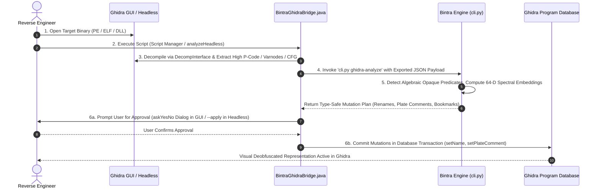

# Ghidra Integration Architecture & Operational Guide (v1.0.0)

## Overview
Bintra provides two complementary integration architectures with Ghidra (target 12.1.x / 11.x):
1. **Asynchronous Localhost IPC Bridge (`ghidra_live_bridge.py` & `BintraLiveBridgeService.py`):** Authenticated localhost JSON-RPC 2.0 server at `127.0.0.1:41718` (`ThreadingMixIn` concurrent HTTP, 5.0s socket timeout, 2 MiB body limit returning HTTP 413, bounded command queue capped at 2000 entries with `queue_overflow_count`). Enqueues Crash RCA attributions, VAD memory maps, reconstructed C data structures (`address_space: "va"`), multi-level pointer scan paths (`address_space: "va"`), and ETW timelines for atomic commit when `BintraLiveBridgeService.py` polls `ghidra.poll_commands` inside Ghidra (~1.0s loop) using `currentProgram.startTransaction(...)`. Workspace markers use confined `.bintra_bridge.json`, while optional system temp markers are mediated via `Capability.TEMPDIR_MARKER_WRITE` (disable with `--no-temp-marker` or `"publish_temp_marker": false`).
2. **File-Exchange + Headless Orchestration (`BintraGhidraBridge.java` & `cli.py ghidra-headless`):** Automates offline batch deobfuscation, High P-Code extraction, and mutation plan generation via Ghidra's `analyzeHeadless.bat`.

---

## The 6-Step Symbiotic Cycle



### Detailed Breakdown of the Steps:
1. **Target Loading:** Analyst loads any compiled Windows executable (`.exe`, `.dll`) or native binary into Ghidra. Auto-analysis runs standard disassembler and decompiler preparation.
2. **Bridge Activation:** Analyst runs `BintraGhidraBridge.java` from Ghidra's Script Manager (category `Bintra`), or executes headless automation via `python src/cli.py ghidra-headless --binary target.exe --apply`.
3. **High P-Code Extraction:** The bridge script uses Ghidra's `DecompInterface` to decompile each function into SSA `HighFunction` representation. It extracts:
   - Full `PcodeOpAST` stream (opcodes, Varnode inputs, Varnode outputs).
   - Control flow graph structure and branch destinations.
   - Function signatures, parameter counts, and entry point RVAs.
4. **Standardized IPC Transfer:** The extracted representation is serialized into a normalized JSON payload and passed directly to the Bintra CLI engine.
5. **Continuous Semantic Analysis:** Bintra's `ghidra-analyze` processes the functions:
   - `PcodeDeobfuscator` scans for algebraic opaque predicates (e.g. `INT_XOR(V, V) -> CBRANCH`, `BOOL_XOR(V, V) -> constant 0`).
   - `PcodeVectorizer` computes the 64-D unit vector and Roy-Vetterli spectral effective rank ($H_{\text{spectral}}$).
   - Generates concrete mutation actions: deobfuscated function renames (`Bintra_Deob_<orig_name>`), detailed plate comments with mathematical evidence, and navigation bookmarks.
6. **Audited Database Mutation:**
   - **Interactive GUI Mode:** Ghidra displays an `askYesNo` confirmation dialog presenting exact counts of analyzed functions, detected opaque predicates, and proposed mutations.
   - **Headless Automated Mode:** Mutations are committed automatically if the `apply` argument is passed.
   - **Atomic Transaction:** All renames and plate comments are wrapped in `currentProgram.startTransaction(...)` and committed cleanly, updating Ghidra's Program Database immediately.

---

## Shipped Components in `ghidra_scripts/` and `src/`

| Component | File Path | Description |
|:---|:---|:---|
| **Live Bridge Daemon** | [`src/ghidra_live_bridge.py`](../../../src/ghidra_live_bridge.py) | Multithreaded localhost JSON-RPC 2.0 bridge server and client with token authentication and mediated discovery markers. |
| **Ghidra Live Service** | [`ghidra_scripts/BintraLiveBridgeService.py`](../../../ghidra_scripts/BintraLiveBridgeService.py) | Python/PyGhidra background script polling the bridge (~1.0s) and committing atomic Ghidra transactions with explicit `rva`/`va` resolution. |
| **Native Java Bridge** | [`ghidra_scripts/BintraGhidraBridge.java`](../../../ghidra_scripts/BintraGhidraBridge.java) | Zero-external-dependency Java `GhidraScript` for offline P-Code extraction and batch mutation. |
| **Python / PyGhidra Bridge** | [`ghidra_scripts/bintra_extract_pcode.py`](../../../ghidra_scripts/bintra_extract_pcode.py) | Python variant for Jython / PyGhidra headless environments. |
| **CLI Analysis Engine** | `python src/cli.py ghidra-analyze` | Batch-processes exported Ghidra JSON files, runs algebraic deobfuscation, and outputs mutation plans. |
| **Headless CLI Orchestrator** | `python src/cli.py ghidra-headless` | Wraps Ghidra's `analyzeHeadless.bat` into a single, automated Bintra command for Windows. |
| **Bridge CLI Controller** | `python src/cli.py ghidra-bridge` | Manages bridge daemon (`--start`, `--daemon`, `--stop`, `--status`, `--no-temp-marker`) and queued diagnostic injections. |

---

## Usage Guide

### Method D: Live Bidirectional Socket Bridge (Real-Time IPC)
1. **Launch Bintra Bridge Daemon:**
   ```powershell
   # Foreground mode:
   python src/cli.py ghidra-bridge --start --port 41718

   # Or background detached daemon:
   python src/cli.py ghidra-bridge --daemon --port 41718
   ```
2. **Start Service in Ghidra GUI:**
   - In Ghidra, open **Script Manager** -> category `Bintra`.
   - Run `BintraLiveBridgeService.py`.
   - The script auto-discovers `.bintra_bridge.json` in temp or workspace and connects.
3. **Stream Live Diagnostics from Bintra to Ghidra:**
   ```powershell
   # Inject Crash RCA from MiniDump:
   python src/cli.py ghidra-bridge --annotate-crash crash.dmp

   # Inject VAD Memory Layout from live process:
   python src/cli.py ghidra-bridge --annotate-vad 1234

   # Dissect runtime structure and inject C composite struct into DataTypeManager:
   python src/cli.py ghidra-bridge --annotate-struct 1234 --addr 0x7FF71000

   # Resolve multi-level pointer chains and annotate static roots:
   python src/cli.py ghidra-bridge --annotate-pointers 1234 --addr 0x7FF71000
   ```
4. **Stop the Bridge Server:**
   ```powershell
   python src/cli.py ghidra-bridge --stop
   ```

### Method A: Inside Ghidra GUI (Interactive Batch)
1. In Ghidra, open the **Script Manager** (`Window` -> `Script Manager`).
2. Click the **Script Directories** icon and add the path: `C:\path\to\bintra\ghidra_scripts`.
3. Filter by category `Bintra`.
4. Select `BintraGhidraBridge.java` and click **Run**.
5. Once analysis completes, review the summary dialog and click **Yes** to apply all deobfuscated renames and comments to the Program Database.

### Method B: From Bintra Unified CLI (Headless Automation)
To deobfuscate and annotate a binary on Windows in a single automated step:
```powershell
python src/cli.py ghidra-headless --binary "C:\path\to\target.exe" --apply
```

### Method C: Offline File Exchange
If analyzing binaries across isolated machines or air-gapped environments:
```powershell
# 1. Analyze exported P-code JSON
python src/cli.py ghidra-analyze --input exported_pcode.json --output mutation_plan.json

# 2. Inspect generated mutation plan
cat mutation_plan.json
```
