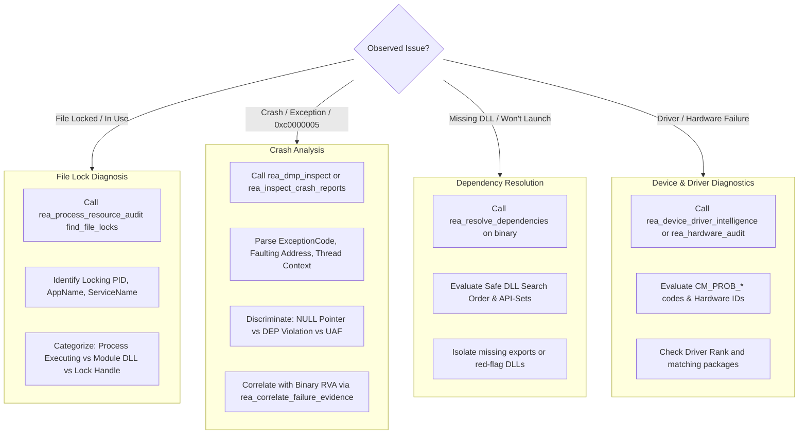

# REA-Neural: Windows System Forensics & Troubleshooting Skill

Use this skill whenever a user reports that a Windows program is crashing, freezing, failing to start, locked by a mystery process, or suffering from driver/dependency conflicts.

---

## 1. When to Activate This Skill

Activate this skill when the user asks:
- *"Why is my application / game crashing on launch?"*
- *"I am getting error `0xc0000005` (Access Violation). What does it mean and where is it crashing?"*
- *"This file / DLL is locked and cannot be replaced or deleted. Which process is locking it?"*
- *"Check this crash dump (`.dmp`) file."*
- *"Why can't Windows find this DLL or API-Set (`api-ms-win-*`)?"*
- *"Why is this device driver failing with Code 43, Code 10, or Code 28?"*
- *"Show me which processes are currently hosting `d3d11.dll` or `steam_api64.dll`."*

---

## 2. Operational Troubleshooting Matrix



---

## 3. Tool Invocations: MCP vs CLI

### Task A: Discovering File Locks (Without Killing Processes)

Instead of using brute-force tools, REA-Neural leverages the native **Windows Restart Manager API**:

**MCP Tool:**
```json
{
  "name": "rea_process_resource_audit",
  "arguments": {
    "action": "find_file_locks",
    "file_path": "C:\\Program Files\\App\\resource.dll"
  }
}
```

**CLI Command:**
```powershell
rea-neural file-locks --file "C:\Program Files\App\resource.dll"
```

**Output Telemetry:**
- `is_actively_executing`: True if running as the main process executable.
- `is_loaded_as_dll`: True if loaded into process address spaces as a module.
- `has_restart_manager_handle`: True if an application holds an open file handle.
- `has_exclusive_lock`: True if locked with exclusive access.
- `locking_processes`: List of `{process_id, application_name, service_name, is_restartable}`.

---

### Task B: Finding Processes Hosting a Specific DLL

**MCP Tool:**
```json
{
  "name": "rea_process_resource_audit",
  "arguments": {
    "action": "find_module_holders",
    "module_query": "d3d12.dll"
  }
}
```

**CLI Command:**
```powershell
rea-neural proc-modules --module d3d12.dll
```

---

### Task C: Diagnosing 0xc0000005 & MiniDump (.dmp) Crashes

**MCP Tool:**
```json
{
  "name": "rea_dmp_inspect",
  "arguments": {
    "dmp_path": "C:\\Users\\User\\AppData\\Local\\CrashDumps\\app.exe.1234.dmp"
  }
}
```

**CLI Command:**
```powershell
rea-neural dmp-inspect --file "C:\path\to\crash.dmp"
```

**How to Interpret the Root Cause for the User:**
- `is_null_pointer_dereference`: The app attempted to read/write address `< 0x10000` (e.g. `[rax+0x18]` where `rax=0`). Tell the user it is an uninitialized pointer or missing null-check.
- `is_dep_violation`: The CPU attempted to execute machine code from a non-executable page (`PAGE_READWRITE`). Tell the user it was blocked by Data Execution Prevention (DEP).

---

### Task D: Auditing DLL Search Order & Missing Dependencies

**MCP Tool:**
```json
{
  "name": "rea_resolve_dependencies",
  "arguments": {
    "binary_path": "C:\\path\\to\\app.exe"
  }
}
```

**CLI Command:**
```powershell
rea-neural resolve-deps --binary "C:\path\to\app.exe"
```

Resolves required imported DLLs, handles `api-ms-win-*` API-Sets, and verifies if required export functions are present.

---

### Task E: Troubleshooting Drivers & Hardware Problem Codes

**MCP Tool:**
```json
{
  "name": "rea_device_driver_intelligence",
  "arguments": {
    "action": "audit",
    "problems_only": true
  }
}
```

**CLI Command:**
```powershell
rea-neural dev-match --problems-only
```

Exposes PnP device instance IDs, active problem codes (`CM_PROB_FAILED_START`, `CM_PROB_CODE_43`), and candidate driver packages in Driver Store.
