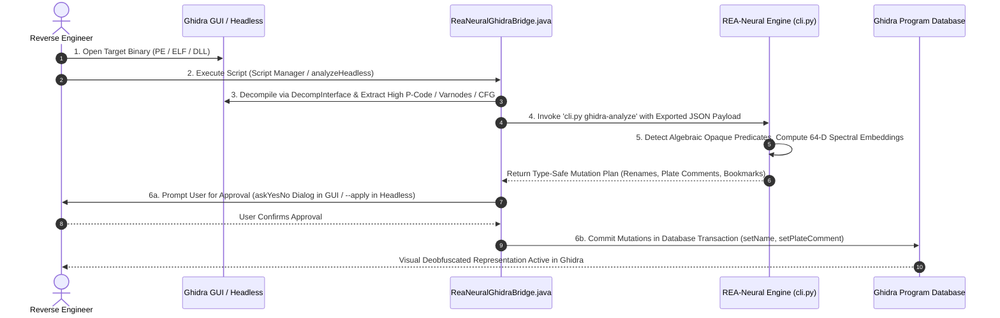

# Ghidra Integration Architecture & Operational Guide (v7.3.0)

## Overview
REA-Neural establishes a verified, bidirectional, closed-loop integration with **Ghidra 12.1.x / 11.x**.
Rather than treating Ghidra as a detached decompiler or requiring manual JSON preparation, REA-Neural provides native in-engine Ghidra scripts (`ghidra_scripts/`) and automated CLI pipelines that execute the complete 6-step symbiotic reverse engineering cycle.

---

## The 6-Step Symbiotic Cycle



### Detailed Breakdown of the Steps:
1. **Target Loading:** Analyst loads any compiled Windows executable (`.exe`, `.dll`) or native binary into Ghidra. Auto-analysis runs standard disassembler and decompiler preparation.
2. **Bridge Activation:** Analyst runs `ReaNeuralGhidraBridge.java` from Ghidra's Script Manager (category `REA-Neural`), or executes headless automation via `python src/cli.py ghidra-headless --binary target.exe --apply`.
3. **High P-Code Extraction:** The bridge script uses Ghidra's `DecompInterface` to decompile each function into SSA `HighFunction` representation. It extracts:
   - Full `PcodeOpAST` stream (opcodes, Varnode inputs, Varnode outputs).
   - Control flow graph structure and branch destinations.
   - Function signatures, parameter counts, and entry point RVAs.
4. **Standardized IPC Transfer:** The extracted representation is serialized into a normalized JSON payload and passed directly to the REA CLI engine.
5. **Continuous Semantic Analysis:** REA's `ghidra-analyze` processes the functions:
   - `PcodeDeobfuscator` scans for algebraic opaque predicates (e.g. `INT_XOR(V, V) -> CBRANCH`, `BOOL_XOR(V, V) -> constant 0`).
   - `PcodeVectorizer` computes the 64-D unit vector and Roy-Vetterli spectral effective rank ($H_{\text{spectral}}$).
   - Generates concrete mutation actions: deobfuscated function renames (`REA_Deob_<orig_name>`), detailed plate comments with mathematical evidence, and navigation bookmarks.
6. **Audited Database Mutation:**
   - **Interactive GUI Mode:** Ghidra displays an `askYesNo` confirmation dialog presenting exact counts of analyzed functions, detected opaque predicates, and proposed mutations.
   - **Headless Automated Mode:** Mutations are committed automatically if the `apply` argument is passed.
   - **Atomic Transaction:** All renames and plate comments are wrapped in `currentProgram.startTransaction(...)` and committed cleanly, updating Ghidra's Program Database immediately.

---

## Shipped Components in `ghidra_scripts/`

| Component | File Path | Description |
|:---|:---|:---|
| **Native Java Bridge** | [`ghidra_scripts/ReaNeuralGhidraBridge.java`](file:///D:/rea-neural/ghidra_scripts/ReaNeuralGhidraBridge.java) | Zero-external-dependency Java `GhidraScript`. Compiles and runs directly in Ghidra 11.x and 12.1.4+. Features full GUI confirmation dialogs and atomic database transactions. |
| **Python / PyGhidra Bridge** | [`ghidra_scripts/rea_extract_pcode.py`](file:///D:/rea-neural/ghidra_scripts/rea_extract_pcode.py) | Python variant for Jython / PyGhidra headless environments. |
| **CLI Analysis Engine** | `python src/cli.py ghidra-analyze` | Batch-processes exported Ghidra JSON files, runs algebraic deobfuscation, and outputs mutation plans. |
| **Headless CLI Orchestrator** | `python src/cli.py ghidra-headless` | Wraps Ghidra's `analyzeHeadless.bat` into a single, automated REA command for Windows. |

---

## Usage Guide

### Method A: Inside Ghidra GUI (Interactive)
1. In Ghidra, open the **Script Manager** (`Window` -> `Script Manager`).
2. Click the **Script Directories** icon and add the path: `D:\rea-neural\ghidra_scripts`.
3. Filter by category `REA-Neural`.
4. Select `ReaNeuralGhidraBridge.java` and click **Run**.
5. Once analysis completes, review the summary dialog and click **Yes** to apply all deobfuscated renames and comments to the Program Database.

### Method B: From REA Unified CLI (Headless Automation)
To deobfuscate and annotate a binary on Windows in a single automated step:
```powershell
python src/cli.py ghidra-headless --binary "C:\path\to\target.exe" --apply
```

### Method C: Offline File Exchange
If analyzing binaries across isolated machines or air-gapped environments:
```powershell
# 1. Analyze exported P-code JSON
python src/cli.py ghidra-analyze --input exported_pcode.json --output mutation_plan.json

# 2. Inspect generated mutation plan
cat mutation_plan.json
```
